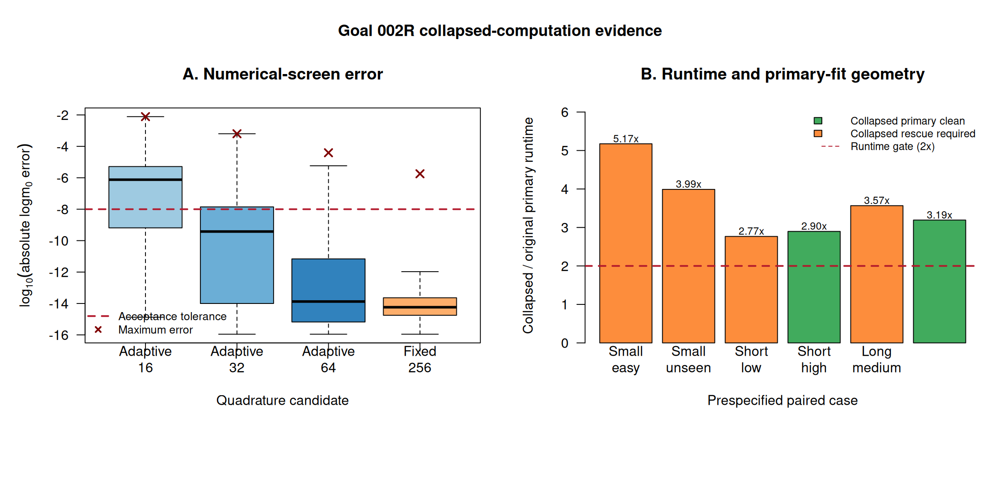

# External consultation: what should follow the Goal 002R collapsed-likelihood experiment?

**Project:** FlexiRich-G, a finite-known-pool estimator of camera-detectable
species richness

**Consultation status:** No decision requested on empirical application; we
are deciding whether a computational repair is worth further development

**Date:** 6 August 2026

## The advice we need

We would value an independent assessment of three linked questions:

1. Is the collapsed formulation scientifically and statistically sound for
   the estimand we have defined?
2. Do the numerical discrepancies below matter at the scale of posterior
   inference, or did we impose an unnecessarily severe integration gate?
3. Given the sampling-geometry improvement but current runtime and numerical
   costs, should we abandon this repair, test one tightly bounded revision, or
   move to a different integration or model formulation?

This document is intended for both statistical ecologists and specialists in
Bayesian computation. We have tried to distinguish prespecified decisions from
our subsequent interpretation. We are not seeking confirmation of a preferred
answer.

## Scientific target

The intended estimand is **whole-grid detectable-use richness during a defined
sampling period**, conditional on a finite, named regional candidate pool. It
is not global richness, anonymous unseen-species richness, local abundance, or
the number of species that physically crossed a camera's field of view.

The eventual motivating dataset is a long-running camera array in southern
Tasmania. Observations will be species-by-camera detection incidence in
seven-day occasions, with exact active camera-days supplied from an existing
daily operational table. The current evidence is entirely synthetic; no
Judbury or Huon Ridge observations have been fitted.

For candidate species \(i\), camera \(j\), and an observation group with
effort \(E\), the prototype uses an encounter hazard

\[
r_{ij}=\exp(\alpha_i+c_j)
\]

and detection probability

\[
p_{ij}(E)=1-\exp\{-E r_{ij}\}.
\]

The species effect follows

\[
\alpha_i=\mu_\alpha+\sigma_\alpha z_i,
\qquad z_i\sim N(0,1),
\]

and \(c_j\) is a partially pooled camera effect. A candidate belongs to the
detectable-use pool with probability \(\omega\). Any species detected at least
once is necessarily a member; a candidate with an all-zero detection history
may be either a non-member or a member with a low encounter rate.

This is deliberately a minimal grid-level model. Species traits, occupancy at
individual cameras, seasonality, spatial dependence, false positives and
site-level richness are deferred. The known candidate pool avoids the
unidentifiable question of how many wholly unspecified species occupy an
arbitrarily low-detection tail.

## Why we attempted a collapsed computation

### Original FlexiRich-G computation

The original model samples one latent encounter effect \(\alpha_i\) for every
candidate, including never-detected candidates. For an all-zero candidate, the
posterior must distinguish

- non-membership, from
- membership plus a sufficiently low \(\alpha_i\).

Those explanations produced weakly identified membership--detectability
ridges. In an earlier frozen synthetic experiment, one important stress case
remained non-clean after the permitted rescue fit. This was an inferential
geometry problem rather than a coding failure.

### Goal 002R computation

Goal 002R retains explicit encounter effects for detected species but
integrates the encounter effect for exchangeable all-zero candidates. Let
\(D\) be detected richness, \(U\) the number of never-detected candidates, and
\(C=D+U\). Conditional on shared parameters, define

\[
m_0=P(\mathbf y_i=\mathbf 0\mid g_i=1)
\]

and

\[
q_{\mathrm{unseen}}
=P(g_i=1\mid \mathbf y_i=\mathbf 0)
=\operatorname{logit}^{-1}\{\operatorname{logit}(\omega)+\log m_0\}.
\]

The conditional richness distribution is then

\[
S_{\mathrm{grid}}\mid\text{shared parameters}
=D+\operatorname{Binomial}(U,q_{\mathrm{unseen}}).
\]

The posterior richness PMF is formed by averaging this binomial PMF over
posterior draws. We do not substitute the posterior mean of
\(q_{\mathrm{unseen}}\).

When all-zero candidates share the same opportunity history and predictors,
this is intended to be a marginal re-expression of the original model, not a
new ecological model. It should therefore improve computation without changing
the posterior beyond numerical and Monte Carlo error. If named candidates
require species-specific traits or opportunities, the collapse would need
strata or a more general marginalization.

## The numerical integral

The all-zero history can be reduced algebraically to

\[
A=\sum_j E_j\exp(c_j),
\]

where \(E_j\) aggregates active days and trials at camera \(j\). Then

\[
m_0=E_Z\left[\exp\{-A\exp(\mu_\alpha+\sigma_\alpha Z)\}\right]
=E_Z\left[\exp\{-\exp(\log B+\sigma_\alpha Z)\}\right],
\quad Z\sim N(0,1),
\]

with \(\log B=\log A+\mu_\alpha\). This is the Laplace transform of a
lognormal variate evaluated at a positive argument. The current Stan model
uses fixed Gauss--Hermite quadrature. The first implementation used order 128
and repeated the all-zero history calculation at every node.

## Prespecified paired experiment

We compared the original and collapsed computations on six identical,
deterministically simulated datasets:

- two small cases, including a short unseen-heavy case;
- three candidate-pool-30 cases spanning low/high richness and short/long
  sampling; and
- the historical non-clean stress case.

Both paths received byte-identical canonical data and the same prior within a
case. Each path was allowed a primary fit and one pre-existing rescue fit.
Strict health gates required zero divergences, zero maximum-treedepth hits,
minimum E-BFMI 0.3, maximum \(\hat R\) 1.01, and minimum bulk and tail ESS 400.
The collapsed computation also had to pass 150 independent comparisons with
R's adaptive `integrate()` at absolute \(\log m_0\) error no greater than
\(10^{-8}\).

Posterior fidelity was assessed for the five cases in which both terminal fits
were clean. The prespecified richness criteria were total-variation distance
at most 0.05, posterior mean difference at most 0.25 species, median difference
at most one species, and each 90% interval endpoint differing by at most one
species. Shared-parameter means had to agree within a threshold combining
pooled posterior SD and Monte Carlo standard error. Median primary runtime for
the collapse could not exceed twice that of the original.

## What happened

The formal decision was **REJECT**. We have preserved that result rather than
retrospectively changing its gates.

| Evidence component | Result | Prespecified requirement |
|---|---:|---:|
| Identical paired data | 6/6 | 6/6 |
| Independent order-128 quadrature checks | 141/150 | 150/150 |
| Valid richness support | 5/5 | 5/5 |
| Richness-PMF fidelity | 4/5 | 5/5 |
| Shared-parameter fidelity | 53/53 | all |
| Collapsed terminal fits clean | 6/6 | 6/6 |
| Historical stress case clean under collapse | yes, on primary fit | yes |
| Median collapsed/original primary runtime | 3.379 | at most 2 |

### Sampling geometry improved

Only one of six original primary fits was clean, compared with two of six
collapsed primary fits. After the single allowed rescue, five original fits
and all six collapsed fits were clean. Most importantly, the historical stress
case remained terminal-non-clean under the original model but was clean on the
collapsed primary fit. All 53 comparisons of shared-parameter posterior means
passed.

This supports the motivation for marginalizing the never-detected encounter
effects. It does not establish that the collapsed posterior is numerically
accurate.

### The PMF miss was narrow

Four of five richness-PMF comparisons passed. The failure was the
`standard-short-low` case: mean richness differed by 0.2866 species against a
0.25 threshold. Its total-variation distance was 0.0192, both medians were 7,
the lower 90% limits were both 1, and the upper limits were 26 versus 27; all
of those components passed.

As a post-decision diagnostic, the 0.2866 difference was 1.69 combined Monte
Carlo standard errors for posterior mean richness. The other four differences
were between 0.25 and 1.67 combined MCSE. We regard this as evidence that
finite-chain variation is a plausible explanation for the isolated mean gate
failure, not grounds to rescore it after seeing the result.

### Fixed order 128 missed the numerical gate

Nine of 150 checked posterior states exceeded \(10^{-8}\) absolute error. The
maximum was \(2.29\times10^{-6}\). The failures occurred at
\(\sigma_\alpha\) from 1.91 to 3.74, whereas passing checked states had a
median \(\sigma_\alpha\) of 1.17. This implicated the broad-heterogeneity part
of the posterior rather than one dataset alone.

### Runtime was materially worse

The collapsed/original primary runtime ratios ranged from 2.77 to 5.17, with a
median of 3.379. The current collapsed Stan implementation evaluates every
all-zero observation group at every quadrature node, so this comparison mixes
the inherent cost of integration with a removable computational inefficiency.

## Bounded numerical revision

We next tested a numerical revision without changing the model, priors,
datasets, samplers or formal tolerances.

First, we reduced the zero-history likelihood to \(A\), which removes the
observation-group loop from every quadrature node. The reduced and row-wise
calculations agreed to \(10^{-12}\) on the prespecified fixtures.

Second, we screened four candidates against adaptive `integrate()` at 750
posterior states: the original 150 states plus 600 additional deterministic
states. The candidates were fixed order 256 and mode-adaptive Gauss--Hermite
orders 16, 32 and 64. For the adaptive calculation, the integrand mode and
local scale were obtained from the principal Lambert-W function.

| Candidate | Passed | Maximum absolute error |
|---|---:|---:|
| Mode-adaptive 16 | 224/750 | \(7.79\times10^{-3}\) |
| Mode-adaptive 32 | 542/750 | \(6.36\times10^{-4}\) |
| Mode-adaptive 64 | 711/750 | \(3.92\times10^{-5}\) |
| Fixed 256 | 743/750 | \(1.80\times10^{-6}\) |

No candidate passed all 750 checks, so the locked stopping rule prevented any
change to Stan or any second paired experiment. The mode-adaptive candidate
was not an improvement at the screened orders. All seven fixed-256 failures
occurred at \(\sigma_\alpha>3.24\), although not every high-variance state
failed.

The complete error table and the 750 sufficient integral states are bundled in
[`evidence/numerical-screen.csv`](evidence/numerical-screen.csv) and
[`evidence/numerical-screen-states.csv`](evidence/numerical-screen-states.csv).
Across those states, \(\log B\) ranged from -5.54 to 3.24 and
\(\sigma_\alpha\) from 0.0026 to 4.68.

## Our current interpretation

We see four plausible, non-exclusive explanations.

### 1. The collapse is conceptually right but our numerical gate is mis-scaled

For fixed order 256, let \(\delta\) be the absolute error in \(\log m_0\).
Because the logistic function is 1/4-Lipschitz,

\[
|\Delta q_{\mathrm{unseen}}|\leq\delta/4.
\]

With at most \(U=29\) never-detected candidates and the observed maximum
\(\delta=1.80\times10^{-6}\), the corresponding pointwise change in expected
richness is bounded by about \(1.31\times10^{-5}\) species. The all-zero
contribution to the log target has derivative \(Uq\) with respect to
\(\log m_0\), so its pointwise absolute change is bounded by
\(U\delta\approx5.22\times10^{-5}\).

These function-value bounds make \(10^{-8}\) look much stricter than required
for richness summaries. However, they do **not** bound errors in derivatives,
Hamiltonian trajectories, or the resulting normalized posterior. A method can
have small function error yet introduce locally troublesome gradient error.

### 2. The high-\(\sigma_\alpha\) posterior is the deeper warning

The numerical failures concentrate in the broad encounter-heterogeneity tail.
This may simply identify the difficult part of an otherwise legitimate model.
Alternatively, \(\sigma_\alpha\) values above 3--4 on the log-hazard scale may
reflect weak identification or an insufficiently regularizing prior. If that
tail is scientifically implausible, improving quadrature would solve the wrong
problem. Any prior revision would need fresh prior-predictive justification;
it cannot be used retrospectively to rescue this comparison.

### 3. The PMF discrepancy is probably not the main obstacle

Total-variation distances and shared-parameter comparisons were good, and the
single mean-richness miss was small relative to its combined MCSE. A longer
paired run or a fidelity criterion that explicitly accounts for Monte Carlo
uncertainty might have passed. The formal failure remains, but we currently
place less weight on it than on integration design and runtime.

### 4. The repair may still cost more complexity than it returns

Collapsing removes a genuine posterior ridge, but it introduces a numerically
difficult integral into every log-density and gradient evaluation. Even if an
exposure-reduced fixed-256 calculation is fast enough and decision-scale
accurate, maintaining a specialized integration method may not be worthwhile
for a research estimator that still requires extensive calibration and
misspecification testing.

## Decision paths we can see

### A. Close Goal 002R

Retain the experiment as evidence that exact-looking marginalization improved
sampling geometry but did not meet its numerical and runtime contract. Return
to the original model, simplify the scientific model, or redirect effort to a
standard multispecies occupancy formulation.

### B. Run one new, decision-scale numerical gate

Prospectively define tolerances on the induced log-target, gradient and
richness-PMF error rather than requiring every \(\log m_0\) value to agree to
\(10^{-8}\). Under those new gates, test the exposure-reduced fixed-256 method,
which came closest and may be much faster after algebraic reduction. If it
passes, run the same six paired cases once. This is our tentative lean option,
but only if experts agree that the proposed error scale is defensible.

### C. Replace Gauss--Hermite quadrature

Investigate a differentiable adaptive one-dimensional integral inside Stan, a
specialized approximation to the lognormal Laplace transform, or a certified
differentiable interpolation over \((\log B,\sigma_\alpha)\). This offers the
best chance of a principled numerical solution but opens a substantially
larger methods-development tranche.

### D. Revisit the ecological hierarchy before more computation

Use prior-predictive and identifiability analysis to decide whether the
high-\(\sigma_\alpha\) tail and exchangeable all-zero candidates are
scientifically defensible. A redesigned or stratified model may remove both
the most difficult numerical regime and an unrealistic ecological assumption,
but it would no longer be a pure computational repair.

## Pointed questions for advisers

### Ecological and inferential formulation

1. Is whole-grid detectable-use membership, conditional on a finite named
   candidate pool, a coherent and useful richness estimand for this camera
   design?
2. Is a common \(q_{\mathrm{unseen}}\) defensible even as a prototype, or does
   knowing the species identities make exchangeability untenable unless we
   include traits, taxonomic groups, or candidate-specific opportunity?
3. Do posterior values of \(\sigma_\alpha\) up to about 4.7 indicate a
   plausible rare/common species mixture, or primarily weak identification?
   What diagnostics would distinguish these explanations?
4. Would you regularize the encounter-effect distribution more strongly,
   replace it, or retain it until broader simulation under misspecification is
   available?

### Numerical accuracy

5. Is uniform absolute error \(\leq10^{-8}\) in \(\log m_0\) an appropriate
   gate, or should accuracy be specified through induced error in the log
   target, its gradient, and posterior functionals?
6. Are the pointwise bounds above sufficient to justify a fresh evaluation of
   fixed order 256, or could gradient error and HMC dynamics still make
   \(10^{-6}\)-scale function errors consequential?
7. Is our mode-and-scale adaptive Gauss--Hermite transformation appropriate
   for this integrand? Does its disappointing performance suggest a derivation
   problem, tail mismatch, or simply too few nodes at large
   \(\sigma_\alpha\)?
8. For the observed domain
   \(\log B\in[-5.54,3.24]\) and
   \(\sigma_\alpha\in[0.0026,4.68]\), what differentiable integration method
   would you recommend inside an HMC target? In particular, would you favor
   Stan's adaptive one-dimensional integration, higher-order fixed quadrature,
   a saddlepoint/Laplace approximation, or a precomputed differentiable
   surrogate with certified error?
9. What numerical checks should be required for derivatives, not only function
   values?

### Computational comparison

10. Is raw primary-fit runtime ratio the right cost metric when the collapse
    changes geometry, or should the decision emphasize effective samples per
    second for key shared parameters and richness functionals?
11. Given that the original implementation redundantly loops over all-zero
    histories at every node, is it reasonable to treat its 3.379 runtime ratio
    as provisional until the exact exposure reduction is implemented?
12. Does the historical stress-case improvement justify one further bounded
    attempt, or is a 5/6-to-6/6 terminal-clean change too little evidence to
    support more specialized computation?

### Posterior fidelity and stopping

13. Should computational-equivalence criteria incorporate combined Monte
    Carlo error explicitly? If so, what would be a defensible paired criterion
    for an integer richness PMF rather than only its mean?
14. Which decision path—A, B, C or D—would you recommend, and what single piece
    of missing evidence would be most likely to change that recommendation?
15. At what point would you conclude that the collapsed formulation is not
    worth the additional methodological and maintenance burden, even if it can
    eventually be made accurate?

## Evidence and reproducibility

The [`evidence`](evidence/README.md) directory contains all compact tables used
above, the full numerical screen, sufficient inputs for independently testing
alternative integrators, and provenance/checksums. It intentionally excludes
large CmdStan draws and generated binaries.

If the full reproducibility archive would help—including all chain CSVs,
simulation inputs, exact code revision, environment lockfile and rerun
commands—we would be very happy to supply it subsequently.
