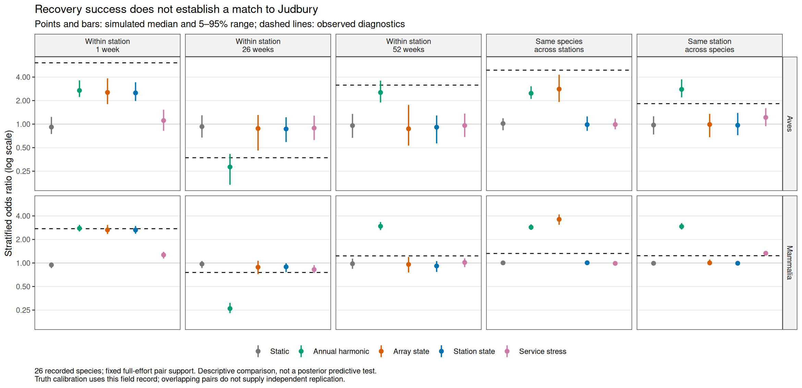

# Goal013 assessment: distinguishable templates, unresolved field mechanism

9 October 2026. **Continue encounter-process development, but do not advance the
array-state template as the empirical explanation.** The oracle screen separates
the three fitted dynamic representations successfully. Its field-diagnostic
check fails: matching short-term mammal clustering with the array template
requires much more cross-station synchrony than Judbury shows. Station states
also absorb omitted shared service variation, so their selection is not a
biological identification. Fable should now challenge the next comparison using
these results and the [review brief](Fable-review-brief.md).

This is an assessment of the frozen run at `df8274015ab5deb9667ce81e2ac545f50f602c73`.
Every candidate knew the full-period species-by-placement expected counts.
Only the 26 recorded species were treated as known members; the 24 unrecorded
candidates were excluded. Neither the simulations nor the following summaries
validate unseen richness or repair the earlier Goal011 field forecast.

## Recovery and proper joint scores

The primary comparison trains through week 52 and scores weeks 53–153. The
frozen two-nat selection rule gives the following counts out of 100 datasets
per truth. Numerical failures remain in the denominator.

| Generating truth | Static-compatible | Harmonic | Array state | Station state | Unresolved | Numerical failure |
|---|---:|---:|---:|---:|---:|---:|
| Static | 95 | 2 | 0 | 1 | 1 | 1 |
| Harmonic | 0 | 99 | 0 | 0 | 0 | 1 |
| Array state | 0 | 0 | 100 | 0 | 0 | 0 |
| Station state | 0 | 0 | 0 | 100 | 0 | 0 |
| Shared service stress | 10 | 0 | 0 | 86 | 4 | 0 |

All core recovery frequency gates pass. The exact 95% lower bounds are 0.887
for 95/100, 0.946 for 99/100 and 0.964 for 100/100. Zero false array selections
under each harmonic, station and service truth gives an upper bound of 0.036.
Own-truth median joint score gains over static are 808 nats for harmonic,
709 for array and 271 for station. These are gains for the entire future panel,
not per-species evidence. Each dynamic model has four fitted parameters.

The secondary week-104 origin recovers all three core dynamic truths in
100/100 datasets, with 98/100 static-compatible choices under static truth.
However, service stress then produces **26 array choices, 26 station choices,
36 static-compatible and 12 unresolved**. The primary false-array gate passes
as specified; the secondary result shows that this protection does not carry
across forecast windows. The stress uses one fixed nuisance realization with
100 stochastic incidence replicates, not 100 independently drawn service
histories. It demonstrates possible aliasing, not its general prevalence.

## The field pattern rejects a single-template interpretation

The bars are descriptive 5–95% simulation ranges on identical full-effort,
placement-stratified pair support. They are not posterior predictive intervals
or independent tests: pairs overlap, and this same field record calibrated
the truths. Selected examples from the complete table are:

| Diagnostic | Observed | Relevant simulated median [5–95%] | Implication |
|---|---:|---:|---|
| Mammal, same species across stations | 1.323 | Array 3.615 [3.080, 4.181] | Array template over-synchronizes encounters |
| Mammal, same species across stations | 1.323 | Station 1.006 [0.943, 1.078] | Independent station chains also miss shared structure |
| Bird, within station at 52 weeks | 3.154 | Harmonic 2.539 [1.891, 3.598] | Annual structure remains a useful comparator |
| Bird, within station at 26 weeks | 0.372 | Harmonic 0.283 [0.167, 0.415] | Alternating annual pattern is compatible with this component |
| Bird, within station at 1 week | 6.084 | Harmonic 2.694 [2.223, 3.629] | Annual structure alone misses short-term clustering |
| Mammal, within station at 52 weeks | 1.233 | Harmonic 2.952 [2.635, 3.344] | Matching short-term mammal clustering with a harmonic imposes too strong an annual cycle |

Every array-truth mammal cross-station odds ratio exceeds the observed value.
Bird cross-station synchrony instead exceeds all 100 array simulations. This
opposite discrepancy is a reason to retain taxon-specific development, not to
replace the array template by independent station states wholesale.

The bird signal was deliberately weakened to 54.07% of its observed switch
deficit because the symmetric two-state truth at persistence 0.8 could not
match the full deficit. These results therefore rule against advancing this
particular shared template; they do not exclude every array-level process,
asymmetric state prevalence, or combinations of seasonal and local variation.
The service stress also fails to reproduce the full observed short-term
clustering at its single prescribed strength. Its value here is demonstrating
confounding, not explaining all field discrepancies.

## Count calibration, sparse species and boundary estimates

Across 60 own-truth count-coverage cells, empirical coverage of nominal 90%
intervals ranges from 0.87 to 1.00. None has an exact 95% upper confidence bound
below 0.90. This passes the specified failure screen; it does not establish
exact calibration. Across all 30,000 count predictions, the discrete intervals
carry fitted probability mass 0.901–1.000, with median 0.966. No cohort is empty.
Known-member cohorts undetected in training contain 2–10 species at week 52
and 1–8 at week 104. Forecasts still omit temporal-parameter uncertainty and
know future-informed spatial margins.

Ten of the 300 coverage cells flag undercoverage, all for misspecified models
at the primary origin and 13- or 26-week horizons. For example, under harmonic
truth the all-known 13-week coverage is 41% for static and station models,
68% for array, and 92% for the correct harmonic. Thus a dynamic model alone
does not guarantee a useful seasonal forecast. These correlated cells are
diagnostic summaries, not independent hypothesis tests.

The ten species with one to three full-record positive cells show almost no
event-score improvement from their correct state model over static. At the
52-week horizon after the primary origin, mean Brier-score improvements are
0.00097 for array and 0.00034 for station; at 101 weeks they are 0.00009 and
−0.00002. The harmonic improves sparse-species Brier score by 0.01354 at the
26-week horizon under its own truth. These are descriptive post-hoc bins,
defined from the frozen full-record incidence totals. They provide no evidence
that individual rare-species mechanisms have become identifiable.

Selection also overstates parameter recovery if judged alone. Under own truth,
the bird state amplitude hits its upper bound of 4 in 18/100 array fits and
30/100 station fits at week 52 (7/100 and 24/100 at week 104), versus a true
amplitude of 1.982. The frozen `boundary` field recorded zero amplitudes and
persistence bounds, but omitted upper amplitude bounds and harmonic bounds.
The assessment recomputes **all** parameter bounds from saved estimates;
the original fits and their summaries remain sealed. Any future runner should
report both ends of every bound.

## Numerical flags and evidence integrity

There are two code-52 fits among 4,000 fits (0.05%), affecting two of 500 primary
selections (0.4%). Both rates are below the 2% numerical tolerance. In
`harmonic-024`, the flagged station objective is only about 1e-8 below the best
converged start. In `static-084`, the flagged array solution has zero amplitudes
and exactly ties four converged starts. These indicate near-tie or boundary
optimization behavior. Full alternative-start parameter vectors were not saved,
so equal predictive distributions are not asserted. The primary counts retain
both failures; neither needs to be reclassified for the screen to pass.

All 4,513 production file hashes and the frozen input hashes passed locally.
The postprocessor checked 260,000 species event rows against saved simulated
panels, reconstructed all 30,000 count scores, reproduced all 1,000 selections,
and verified identical pair support for the field and simulations. An
[independent assessment](evidence/results-independent-review.md) reached the
same main interpretation. No new fitted model or empirical outcome was used.

## Proposed next tranche for scientific review

First estimate placement rates and a parsimonious station/service nuisance
component from training data, with taxon-specific annual variation as a
comparator. Test the combined seasonal-plus-service truth as well as each
component and the static boundary; use multiple nuisance realizations and
propagate parameter uncertainty. Keep known membership fixed initially so this
step tests forecasting without simultaneously reopening the richness problem.
Carry residual local and array state candidates as falsifiers where the
diagnostics justify them, rather than treating the present winner as causal.

The discriminating target is useful sparse-member forecasting and compatible
temporal/cross-station diagnostics after nuisance estimation. A candidate that
needs excessive mammal synchrony, retains boundary-driven bird amplitude
estimates, or merely re-labels service variation as species persistence should
not advance. No broad amplitude-grid expansion is warranted just to improve
the current recovery percentages.

This is a proposed design direction, not a newly frozen run contract. Fable's
review should settle its smallest informative comparison before implementation.
Bird labeling consistency remains unresolved, so a secular bird trend is not
yet interpretable. The full Judbury record has already informed development;
a retrospective split cannot now supply a fresh independent field validation.
Any new Judbury period or Huon Ridge assessment needs a separate data and
candidate-pool decision. Huon Ridge remains unopened.
